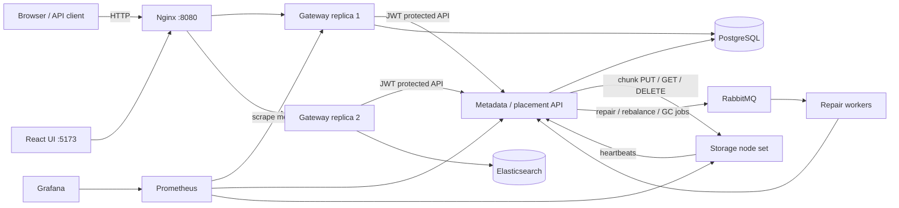

# Distributed Object Storage System: Architecture and Structure

**Purpose.** This report describes the current exam-project implementation: its services, request/data flows, repository layout, local deployment, and remaining boundaries. It distinguishes the implemented local system from the cloud deployment template.

## 1. Architecture at a glance



The diagram shows the intended Compose topology. Actual running replicas and health should be confirmed with `docker compose -f compose.storage.yaml ps`; a configuration file alone does not prove live service availability.

## 2. Main components

| Component | Responsibility | Main implementation/config |
| --- | --- | --- |
| React/Vite UI | Sign in; browse, upload, download, search, and inspect cluster status | `frontend/src/`, `frontend/Dockerfile` |
| Nginx | Entry point and reverse proxy to gateway replicas | `infra/nginx.conf`, `compose.storage.yaml` |
| FastAPI gateway | JWT auth, rate limiting, object/bucket API, streaming/range handling, search requests, cluster view | `gateway_service/app.py`, `gateway_service/Dockerfile` |
| Metadata API | Chunking, manifests, deduplication/refcounts, consistent-hash placement, durability policy, heartbeats, reads/writes, repair and scrub operations | `metadata_service/app.py`, `chunking.py`, `ring.py`, `reliability.py`, `metadata_service/Dockerfile` |
| PostgreSQL | Persistent object manifests, bucket policies, nodes, chunk references/placements, repair records and counters | Compose `postgres`, persistent `metadata-postgres` volume |
| Storage nodes | SHA-256 addressed chunk/fragment files on local persistent disks; verify hashes on read; report heartbeats | `storage_node/app.py`, `storage_node/Dockerfile`; Compose volumes or Kubernetes PVCs |
| RabbitMQ | Durable job queues for repair, rebalance, and garbage collection | `compose.yaml`; queue publisher in metadata API |
| Job worker | Consumes RabbitMQ jobs and calls metadata maintenance handlers | `scripts/job_worker.py`, `scripts/Dockerfile.worker` |
| Elasticsearch | Search index for gateway object metadata queries | Compose `elasticsearch` service |
| Prometheus | Scrapes gateway, metadata, and node metrics | `infra/prometheus.yml` |
| Grafana | Visualizes throughput, latency, node disk/chunks, degraded objects, and repair counters | `infra/grafana/dashboards/` |

## 3. Data flows

### Object upload

1. The client sends a request to the gateway through Nginx. The gateway authenticates it and streams the body to the metadata API.
2. The metadata API splits content using fixed-size or content-defined chunking, hashes each logical chunk, and uses the consistent-hash ring to choose storage targets.
3. Depending on the bucket policy, the chunk is stored as replicas or encoded data/parity fragments. PostgreSQL records the ordered object manifest, object metadata, placements, and reference counts.
4. The gateway updates the Elasticsearch metadata index for search.

### Download and integrity

The gateway requests the object from metadata. Metadata reads the needed fragment quorum, reconstructs erasure-coded data where applicable, verifies the logical content hash, and streams the result back. Storage nodes independently verify each addressed chunk/fragment against SHA-256 before returning it. The gateway supports byte-range reads.

### Node health and maintenance

Storage nodes periodically heartbeat with node ID, address, free space, and chunk count. Metadata records node state and enqueues repair work after failures; new or recovered nodes enqueue a rebalance job. Workers consume repair, rebalance, and garbage-collection queues and invoke the corresponding metadata handlers. Scrubbing checks stored fragments for corruption and schedules repair.

### Observability

Prometheus scrapes HTTP metrics. Grafana queries Prometheus for gateway request rate/latency, free disk and chunk counts per storage node, degraded object count, repair count, and repair bytes. Check `/targets` in Prometheus for scrape health before interpreting dashboard gaps as zero activity.

## 4. Repository structure

```text
distributed-mid/
├── gateway_service/       # Gateway API and its service Dockerfile
├── metadata_service/      # Metadata API, chunking, ring, durability/repair logic
├── storage_node/          # Content-addressed node API and Dockerfile
├── frontend/              # React/Vite app, package lock, UI Dockerfile
├── scripts/               # Live verifiers, workload benchmark, RabbitMQ worker
├── tests/                 # Pytest unit/API algorithm checks
├── reports/               # Saved verification outputs and benchmark results
├── compose.yaml            # Prometheus, Grafana, Kafka, RabbitMQ
├── compose.storage.yaml   # API, PostgreSQL, Elasticsearch, nodes, Nginx, UI, workers
├── deploy/kubernetes/     # Storage StatefulSet and cloud HPA template
├── infra/                 # Nginx, Prometheus, Grafana provisioning
├── postman/               # Gateway API collection
└── docs/                  # Task instructions and this architecture report
```

Synthetic many-small/few-large workload inputs are generated by `scripts/benchmark_storage.py`; benchmark outcomes are preserved under `reports/`.

## 5. Deployment model

### Local

`compose.yaml` starts shared development dependencies and observability. `compose.storage.yaml` runs the object-storage services and exposes local ports: gateway through Nginx on 8080, metadata on 8100, PostgreSQL on 5433, Elasticsearch on 9200, storage nodes on 8201–8208 (node 8 is opt-in), and UI on 5173. Prometheus/Grafana are on 9090/3000; RabbitMQ management is on 15672.

### Kubernetes/cloud

`deploy/kubernetes/task8-cloud.yaml` is a provider-neutral template with a storage StatefulSet/PVCs, gateway Deployment, cloud `LoadBalancer` Service, and gateway HPA. It expects images already published to a registry, configured secrets, Metrics Server, and working metadata/database/RabbitMQ endpoints. It does not provision an AWS/GCP/Azure cluster or those managed dependencies. No live cloud deployment is implied by the presence of the manifest.

## 6. Current limitations and interpretation

- Local Compose metadata uses a single PostgreSQL instance; metadata availability is not highly available.
- The cloud manifest is a deployment template and has not been validated against a live cloud provider cluster.
- Kubernetes storage pods require metadata and supporting services reachable inside the Kubernetes network; Compose DNS names do not automatically resolve in Kubernetes.
- Gateway rate-limit state is process-local, so replicas do not share a global request quota.
- RabbitMQ management-API polling acknowledges a message when dequeued; it does not provide the same redelivery guarantees as manual-ack AMQP consumption.
- The repository has no Task 7 specification/documentation. See per-task READMEs for the implemented scope and test evidence.

## 7. Verification entry points

```powershell
.\.venv\Scripts\python.exe -m pytest -q
.\.venv\Scripts\python.exe scripts/verify_containers.py
.\.venv\Scripts\python.exe scripts/verify_metadata.py
.\.venv\Scripts\python.exe scripts/verify_reliability.py
.\.venv\Scripts\python.exe scripts/verify_gateway.py
Push-Location frontend; npm run lint; npm run build; Pop-Location
```

Use [README.md](../README.md) as the project index and `docs/<task>/README.md` for task-specific startup and testing instructions.
